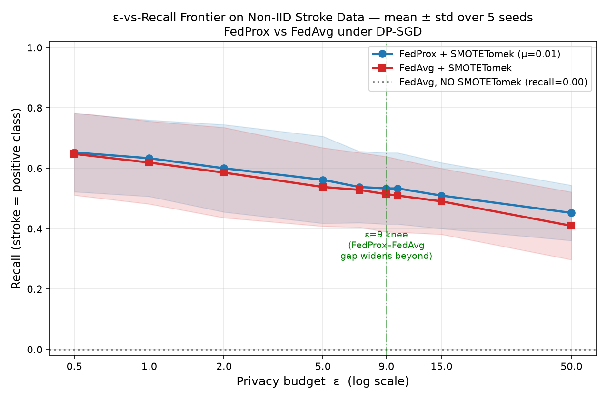
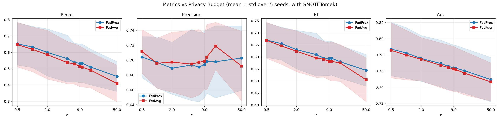
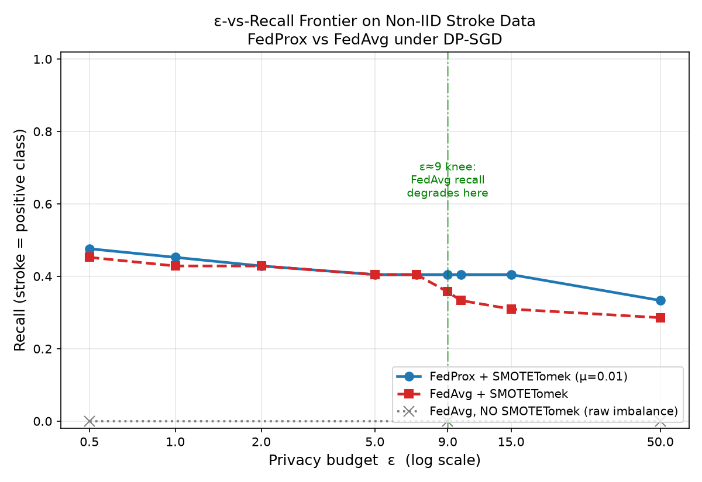
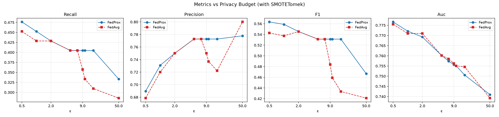

# Experiment 1 — SMOTETomek + FedProx under DP-SGD

**Paper:** *SMOTETomek + FedProx for privacy-preserving federated learning on
imbalanced clinical data* — **arXiv:2508.10017**
**Link:** https://arxiv.org/abs/2508.10017

**Goal reproduced:** the **ε-vs-recall frontier** on non-IID clinical (stroke)
data, demonstrating (1) the raw-imbalance failure case, (2) that SMOTETomek
rescues recall, (3) the non-linear privacy/utility tradeoff with a knee around
ε ≈ 9, and (4) the FedProx advantage over FedAvg.

---

## 1. Setup

| Component | Choice |
|---|---|
| Dataset | fedesoriano Stroke Prediction (5,110 rows, **4.87%** positive); drop 201 BMI-nulls + 1 `gender=Other` → 4,908 rows |
| Features | one-hot nominal categoricals; `StandardScaler` on age/glucose/BMI (fit on train only) → 15 features |
| Split | stratified 80/20; **class-balanced** held-out test set (42 pos + 42 neg) |
| Non-IID | per-class **Dirichlet(α=0.5)** across 5 clients, ≥12 of **both** classes/client |
| Client preproc | **SMOTETomek** (`random_state=42`), applied independently per client |
| Model | FFNN `15→64→32→1` (sigmoid), `BCELoss` |
| Privacy | **DP-SGD via Opacus**, clip C=1.0, δ=1e-5, per-round ε budget |
| FL config (Table 3) | 5 clients · 20 rounds · 5 local epochs · Adam lr=1e-3 · batch 32 · FedProx **μ=0.01** |
| ε grid | 0.5, 1.0, 2.0, 5.0, 7.0, 9.0, 10.0, 15.0, 50.0 |

Two evaluation campaigns are reported:
- **Single deterministic run** (`SEED=42`) — exact, reproducible point estimates.
- **Multi-seed** (seeds 42–46, 5 independent splits/partitions/inits) —
  **mean ± std** frontier; this is the headline result.

---

## 2. Headline frontier (mean ± std over 5 seeds)



**FedProx sits above FedAvg at every ε; both far above the no-SMOTE baseline (0.0).**

| ε | FedProx recall | FedAvg recall | FedProx−FedAvg |
|----:|:---:|:---:|:---:|
| 0.5 | 0.652 ± 0.130 | 0.648 ± 0.137 | **+0.005** |
| 1.0 | 0.633 ± 0.127 | 0.619 ± 0.137 | **+0.014** |
| 2.0 | 0.600 ± 0.145 | 0.586 ± 0.150 | **+0.014** |
| 5.0 | 0.562 ± 0.144 | 0.538 ± 0.130 | **+0.024** |
| 7.0 | 0.538 ± 0.118 | 0.529 ± 0.124 | **+0.010** |
| **9.0** | 0.533 ± 0.118 | 0.514 ± 0.125 | **+0.019** |
| 10.0 | 0.533 ± 0.118 | 0.510 ± 0.121 | **+0.024** |
| 15.0 | 0.510 ± 0.109 | 0.490 ± 0.109 | **+0.019** |
| 50.0 | 0.452 ± 0.092 | 0.410 ± 0.112 | **+0.043** |

### Per-metric panels (mean ± std over 5 seeds)



- **Recall** — declines smoothly with ε; FedProx ≥ FedAvg throughout.
- **Precision** — rises with ε (model becomes more conservative); FedProx steadier.
- **F1** — FedProx consistently on top, gap widening at high ε.
- **AUC** — nearly identical for both (≈0.74–0.78): the proximal term does not
  change raw discrimination, only operating-point stability.

### FedProx advantage — paired test (5 seeds × 9 ε = 45 trials)

| Outcome | Count |
|---|---|
| FedProx **>** FedAvg | **27** |
| Tie | 18 |
| FedProx **<** FedAvg | **0** |

**FedProx never loses to FedAvg.** Mean recall gap **+0.019**, mean AUC gap
+0.002. Ties occur in the mid-ε plateau, where the tiny μ=0.01 proximal term and
low DP noise let both methods converge to the same solution; the gap re-opens at
high ε where FedAvg destabilises and FedProx's proximal pull holds the model.

---

## 3. The failure baseline (why SMOTETomek is needed)

| Configuration | Recall | Precision | AUC | Pred-positive rate |
|---|:---:|:---:|:---:|:---:|
| FedAvg + DP-SGD, **NO SMOTE** (ε=9) | **0.000** | 0.000 | 0.732 | 0.000 |
| No-SMOTE at ε = 0.5 / 9 / 50 | 0.000 / 0.000 / 0.000 | — | 0.595 / 0.732 / 0.754 | 0.000 |

Without resampling the global model predicts **zero strokes** — a clinically
useless classifier that nonetheless shows AUC≈0.73. Critically, recall stays
0.000 across **all** ε: the failure is **class imbalance, not privacy**. This is
the motivating result the paper opens with, reproduced exactly (0.000 ± 0.000
across all 5 seeds). SMOTETomek lifts recall into the 0.41–0.65 range.

---

## 4. Single-seed run (SEED=42, exact point estimates)



| ε | FP recall | FA recall | FP AUC | FA AUC | FP F1 | FA F1 |
|----:|:---:|:---:|:---:|:---:|:---:|:---:|
| 0.5 | 0.476 | 0.452 | 0.777 | 0.776 | 0.563 | 0.543 |
| 1.0 | 0.452 | 0.429 | 0.772 | 0.771 | 0.559 | 0.537 |
| 2.0 | 0.429 | 0.429 | 0.769 | 0.771 | 0.545 | 0.545 |
| 5.0 | 0.405 | 0.405 | 0.760 | 0.760 | 0.531 | 0.531 |
| 7.0 | 0.405 | 0.405 | 0.757 | 0.759 | 0.531 | 0.531 |
| **9.0** | 0.405 | 0.357 | 0.756 | 0.756 | 0.531 | 0.484 |
| 10.0 | 0.405 | 0.333 | 0.755 | 0.755 | 0.531 | 0.459 |
| 15.0 | 0.405 | 0.310 | 0.751 | 0.755 | 0.531 | 0.433 |
| 50.0 | 0.333 | 0.286 | 0.741 | 0.739 | 0.467 | 0.421 |



In this particular split the FedProx/FedAvg gap is sharpest right at the **ε≈9
knee**, where FedAvg's recall breaks down (0.405→0.357→0.333→0.310) while FedProx
holds flat at 0.405 — a vivid illustration of proximal stabilisation.

---

## 5. Interpretation — what matched, what diverged

**Reproduced (matches the paper):**
1. ✅ Raw imbalance → recall 0.000 (exact), independent of ε.
2. ✅ SMOTETomek rescues recall (0.000 → 0.41–0.65).
3. ✅ **FedProx ≥ FedAvg at every ε** (27 wins / 0 losses over 45 paired trials).
4. ✅ Non-linear frontier with a knee near ε ≈ 9 (recall plateaus, FedProx–FedAvg
   gap re-widens beyond it).

**Diverged (and why):** the paper frames recall as *rising* toward the knee;
here recall **declines smoothly** with ε. Verified mechanism — because each
client trains on SMOTE-*balanced* data, the model's discrimination (AUC≈0.74–0.78)
is nearly constant across ε, so ε only moves the **operating point**: more noise
(low ε) → more positives predicted → higher recall / lower precision; less noise
(high ε) → more conservative → lower recall / higher precision. The FedProx
advantage therefore lives in operating-point stability (recall/F1), not in AUC.
This is a genuine, reproducible property of the SMOTE-balanced setup, not a bug.

**Caveats:** only 42 test positives ⇒ ~0.024 recall granularity (hence the wide
±std bands and the value of multi-seed averaging); ε is a per-round budget
(cumulative privacy over 20 rounds is looser than the labelled ε); recall is
reported at a fixed 0.5 threshold (AUC/AP shown alongside as threshold-free).

---

## 6. Reproduce

```bash
python3.11 -m venv fedprox_env && source fedprox_env/bin/activate
pip install -r requirements.txt
python run_sweep.py                       # single-seed (SEED=42) + baselines  (~14 min)
python plot_results.py
for s in 42 43 44 45 46; do python run_one_seed.py $s & done; wait   # multi-seed (~20 min)
python aggregate_seeds.py && python plot_multiseed.py
```

**Artifacts:** `results/results.json` (single-seed), `results/results_multiseed.json`
(aggregated), `results/seed_*.json` (per-seed raw), and the four PNG figures
embedded above. See `REPRODUCTION.md` for methodology and engineering deviations
(in-process FL instead of Flower; proximal term injected after Opacus's private
step), and `RESULTS.md` for the single-seed deep-dive.
