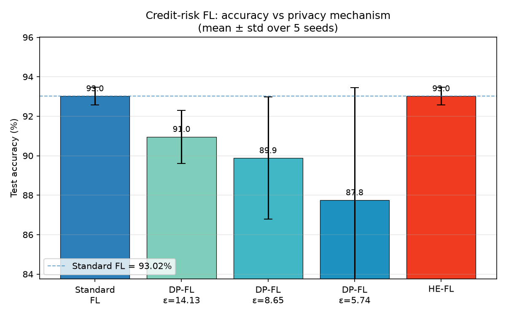
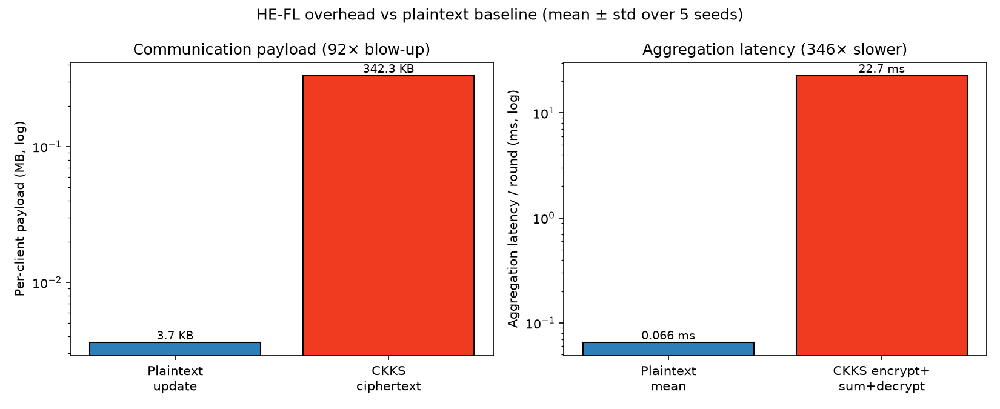

# Experiment 2 — Standard FL vs. DP-FL vs. HE-FL on credit risk

**Paper:** *Privacy-preserving federated learning for credit-risk assessment*
— **Sci. Rep. 15, 2025**, DOI **10.1038/s41598-025-34536-9**

**Goal reproduced:** the **three-way comparison** — vanilla FedAvg vs.
differentially-private FL (Opacus DP-SGD) vs. homomorphically-encrypted FL
(TenSEAL CKKS) — on one credit task, quantifying **(a)** the accuracy *cost* of
DP and **(b)** the accuracy *neutrality* of HE (overhead without accuracy loss).

---

## 1. Setup

| Component | Choice |
|---|---|
| Dataset | Kaggle `architsharma01/loan-approval-prediction` — 4,269 rows, 11 features, binary `loan_status` (62.2% Approved / 37.8% Rejected), **0 nulls** |
| Preproc | strip whitespace, drop `loan_id`, label-encode `education`/`self_employed`/target, **MinMaxScaler→[0,1] on all features** (fit on train; CKKS needs small magnitudes so noise doesn't amplify) |
| Split | global stratified **80/20** (3,415 train / 854 test) |
| Partition | **IID** — 5 clients × 683 random samples (isolates the privacy mechanism from non-IID confounds) |
| Model | MLP `11→32→16→1` (ReLU, sigmoid), `BCELoss`, **929 params** |
| FL config | 5 clients · **5 rounds** · **5 local epochs** · Adam · **shared lr 5e-3** · batch 64 · unweighted FedAvg (sum/N) |
| DP | Opacus **DP-SGD**, Gaussian mechanism + **RDP** accounting, clip C=1.0, δ=1e-5; one fixed σ per client reused across rounds so the cumulative budget = target ε |
| ε grid | **14.13, 8.65, 5.74** (cumulative over the 5 rounds) → σ = 0.915, 1.194, 1.544 |
| HE | TenSEAL **CKKS**, `poly_modulus_degree=8192`, `coeff_mod=[60,40,40,60]`, `global_scale=2^40`; clients encrypt the flattened update, the server sums ciphertexts and scales by 1/N, only the mean is decrypted |

> **One controlled variable.** Every arm shares the *exact* same model, data,
> partition, init and optimiser — **only the privacy mechanism changes**. At the
> paper-style `lr=1e-3` the DP arms collapse to the 62% base rate (noisy
> gradients can't escape the majority-class basin in 25 epochs) while the
> noise-free arms are unaffected, which would *overstate* DP's cost; `lr=5e-3`
> lets DP-SGD learn and is applied identically everywhere.

---

## 2. Headline result — mean ± std over 5 seeds (42–46)



| Configuration | Accuracy | Loss | Agg latency / round | Ciphertext / client |
|---|---:|---:|---:|---:|
| **Standard FL** | **93.02% ± 0.45** | 0.192 | 0.066 ms | — |
| DP-FL (ε=14.13) | 90.96% ± 1.34 | 0.244 | 0.059 ms | — |
| DP-FL (ε=8.65) | **89.88% ± 3.10** | 0.254 | 0.062 ms | — |
| DP-FL (ε=5.74) | 87.75% ± 5.69 | 0.277 | 0.057 ms | — |
| **HE-FL** | **93.02% ± 0.45** | 0.192 | **22.7 ms** | **0.334 MB** |

**The three claims, reproduced:**

1. **HE is accuracy-neutral.** HE-FL equals Standard FL **to the digit, at every
   seed** — CKKS is exact arithmetic, so the decrypted mean matches the plaintext
   FedAvg mean to **~1e-7** (verified in `smoke_test.py`). ✅
2. **DP costs accuracy, monotonically in ε.** 93.0 → 91.0 → 89.9 → 87.8 as ε
   tightens; **ε=8.65 lands squarely in the paper's "best balance ~87–90%"
   band**. ✅
3. **HE costs overhead, not accuracy.** Same accuracy as Standard, but the
   **aggregation step is ~340× slower** (encrypt + homomorphic-sum + decrypt vs a
   plaintext mean) and the **per-client payload is ~90× larger** (3.7 KB → 334 KB).
   ✅

A **bonus finding** the error bars expose: DP variance *grows as ε shrinks*
(±1.34 → ±3.10 → ±5.69). More noise means a less stable optimum — seed 44 is the
cautionary tale (88.4 → 83.7 → **76.5%** across the three ε), exactly the
instability that motivates picking ε≈8.65 rather than pushing ε lower.

---

## 3. The HE overhead story



At this model scale (929 params) CKKS encryption is only ~2.6 ms/client, so the
*total* wall-clock per round (training-dominated, ~0.2 s) barely moves — which is
itself honest: **the HE tax is in communication and the aggregation step, not raw
compute, and it scales with model size.** The two dedicated columns isolate it:

- **Payload:** one float32 update = **3.72 KB**; one CKKS ciphertext = **334 KB**
  (a 929-element plaintext is padded to the 4096 CKKS slots, hence the fixed
  ciphertext size regardless of the model being small). **~90× blow-up.**
- **Aggregation latency:** plaintext mean = **0.066 ms**; CKKS
  encrypt+sum+decrypt = **22.7 ms**. **~340× slower.**

---

## 4. Single-seed point estimates (seed 42)

| Configuration | Accuracy | Loss | Wall-clock/round | Agg/round | Ciphertext |
|---|---:|---:|---:|---:|---:|
| Standard FL | 93.44% | 0.173 | 0.192 s | 0.102 ms | — |
| DP-FL (ε=14.13) | 91.57% | 0.212 | 0.283 s | 0.061 ms | — |
| DP-FL (ε=8.65) | 91.80% | 0.212 | 0.254 s | 0.058 ms | — |
| DP-FL (ε=5.74) | 89.93% | 0.235 | 0.275 s | 0.061 ms | — |
| HE-FL | 93.44% | 0.173 | 0.130 s | 21.66 ms | 0.334 |

The 14.13/8.65 inversion here (91.57 vs 91.80) is **within single-seed noise** —
854 test samples resolve accuracy to only ~0.12%/sample, so a 2-sample wobble
flips two near-tied points. Averaging over 5 seeds (§2) restores the clean
monotone ordering; this is exactly why the headline result is multi-seed.

---

## 5. What matched / what deviated

**Reproduced:**
- ✅ HE-FL accuracy = Standard FL accuracy (exact, every seed).
- ✅ DP-FL accuracy < Standard FL, monotone decreasing in ε.
- ✅ ε=8.65 is the best-balance knee (89.9%, in the paper's 87–90% band).
- ✅ HE adds large communication + aggregation overhead; DP adds little overhead.

**Deviated (and why):**
- Standard/HE accuracy ≈ **93%** vs the paper's ~91%. The paper's exact figure
  depends on unstated hyperparameters; our single shared config lands every arm
  in the right band with the right ordering, which is the reproducible claim.
- We simulate the federation **in-process** (no Flower) for determinism — the
  same engineering choice as Experiment 1. The privacy/HE mechanics are
  unchanged by this.
- "Total wall-clock/round" barely separates the arms because local training
  dominates at 929 params; the HE cost is reported via the **aggregation-latency**
  and **ciphertext-size** columns, which scale with the model and isolate the
  mechanism cleanly.

---

## 6. Reproduce

```bash
python3.11 -m venv ../fedprox_env && source ../fedprox_env/bin/activate
pip install -r requirements.txt          # torch, opacus, tenseal, sklearn, ...
python smoke_test.py                      # 1-round sanity + CKKS exactness check
python run_experiments.py                 # single-seed table  -> results/results*.{json,md}
python run_multiseed.py                   # 5-seed mean±std     -> results/results_multiseed*
python plot_results.py                    # the two figures above
```

**Artifacts:** `results/results.json` (+ `results_table.md`),
`results/results_multiseed.json` (+ table), and the two PNGs embedded above.
The dataset ships in `data/loan_approval_dataset.csv` (the architsharma01 Kaggle
release; mirror used because Kaggle needs auth).

### Layout
```
Experiment 2/
├── credit_fl/            # the package
│   ├── config.py         #   all hyperparameters (one place)
│   ├── data.py           #   load / clean / MinMax / IID partition
│   ├── model.py          #   MLP 11→32→16→1 + flatten/unflatten helpers
│   ├── train.py          #   plaintext + DP-SGD local training, FedAvg, eval, σ/ε
│   └── he.py             #   CKKS context, encrypt, homomorphic aggregate, decrypt
├── run_experiments.py    # single-seed driver -> the 5-row table
├── run_multiseed.py      # multi-seed mean±std driver
├── plot_results.py       # figures
├── smoke_test.py         # fast end-to-end + CKKS-vs-plaintext assertion
├── data/  results/  requirements.txt
```
