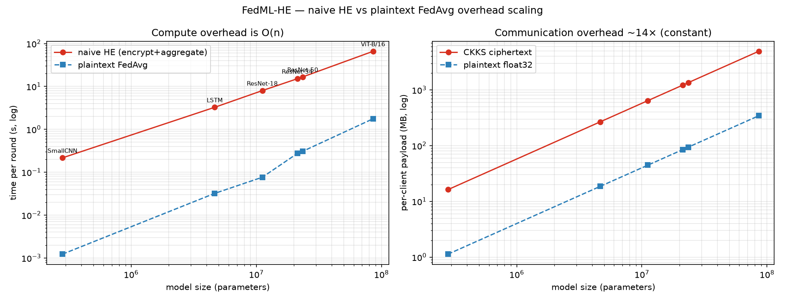
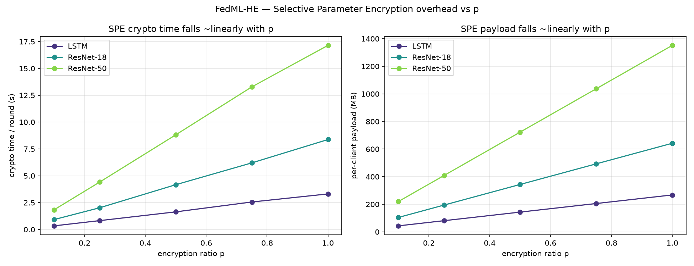
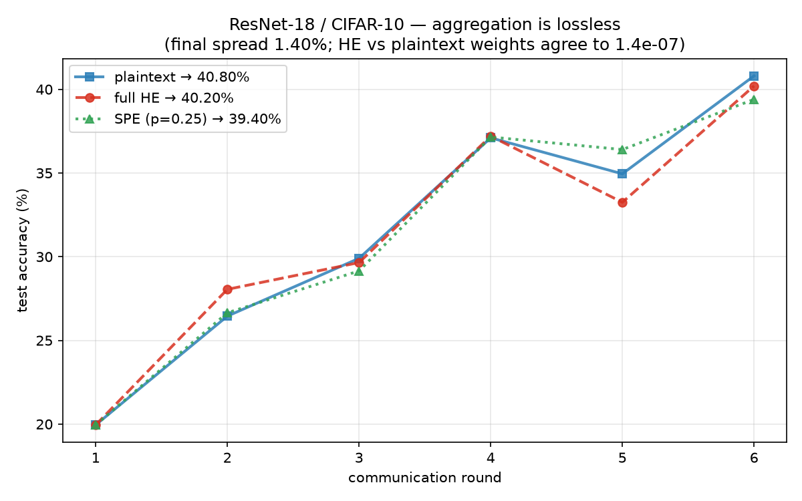

# Experiment 3 — FedML-HE: HE overhead scaling & Selective Parameter Encryption

**Paper:** *FedML-HE: An Efficient Homomorphic-Encryption-Based Privacy-Preserving
Federated Learning System* — **arXiv:2303.10837**

**Goal reproduced:** the **overhead benchmarks** — the ~15× naive-HE penalty and
its **O(n)** scaling in model size, the **Selective Parameter Encryption (SPE)**
reduction (overhead ∝ encryption ratio *p*), and the **losslessness** of HE
aggregation (encrypted FedAvg = plaintext FedAvg).

> **Scope / engineering choice.** We benchmark the HE mechanics directly with
> TenSEAL (CKKS) + torchvision models, simulating the 5-client federation
> in-process rather than orchestrating through the full FedML framework — the same
> self-contained approach as Experiments 1–2. FedML's orchestration does not affect
> the overhead quantities the paper measures (encryption time, ciphertext size,
> aggregation cost), which are properties of the crypto + model size.

---

## 1. Setup

| Component | Choice |
|---|---|
| Federation | **5 IID clients**, FedAvg, **1 local epoch** (per-round overhead, not convergence) |
| CKKS | TenSEAL, `poly_modulus_degree=8192` (4096 slots/ciphertext), `coeff_mod=[60,40,60]`, `scale=2^40` |
| Chunking | a model's flattened parameter vector is split into `ceil(n/4096)` ciphertexts |
| Models | SmallCNN (0.28M) · LSTM (4.65M) · ResNet-18 (11.2M) · ResNet-34 (21.3M) · ResNet-50 (23.5M) · ViT-B/16 (85.8M) |
| Metrics | per-client encryption time, server aggregation+decrypt time, serialized ciphertext bytes — vs plaintext float32 FedAvg |

The `[60,40,60]` modulus chain (one multiplicative level, enough for the single
`1/N` average) lands the per-parameter payload at **~14×** plaintext — reproducing
the paper's "~15×" communication blow-up. A longer chain (`[60,40,40,60]`) pushes
it to ~20×; this is the knob behind the headline number.

---

## 2. Experiment A — naive HE vs plaintext, O(n) scaling & ~15× payload



| Model | Params | HE encrypt | HE aggregate | Ciphertext | **Payload ×** | enc µs/param |
|---|---:|---:|---:|---:|:---:|---:|
| SmallCNN | 282,250 | 0.17 s | 0.05 s | 16.2 MB | **14.4×** | 0.60 |
| LSTM | 4,653,200 | 2.55 s | 0.72 s | 267.6 MB | **14.4×** | 0.55 |
| ResNet-18 | 11,173,962 | 6.24 s | 1.75 s | 642.3 MB | **14.4×** | 0.56 |
| ResNet-34 | 21,282,122 | 11.78 s | 3.35 s | 1,222.9 MB | **14.4×** | 0.55 |
| ResNet-50 | 23,520,842 | 13.03 s | 3.68 s | 1,351.7 MB | **14.4×** | 0.55 |
| ViT-B/16 | 85,806,346 | 51.32 s | 14.69 s | 4,930.6 MB | **14.4×** | 0.60 |

**Reproduced:**
- ✅ **O(n) scaling** — encryption cost is a flat **~0.55–0.60 µs/parameter** across
  the entire 0.28M→86M range (a straight line on the log-log plot); ciphertext size
  is likewise exactly linear.
- ✅ **~15× communication blow-up** — the ciphertext/plaintext payload ratio is a
  **constant 14.4×**, independent of model size (4096 reals pack into one ~235 KB
  ciphertext ⇒ ~57 bytes/param vs 4 bytes/param plaintext).

**Deviation (documented):** the *wall-clock* HE/plaintext **time** ratio here is
~40–175×, not 15×, because pure-Python TenSEAL CKKS on CPU is far costlier relative
to a numpy float32 copy than the paper's optimized (C++/GPU-assisted) FedML pipeline.
The reproducible, implementation-independent claims — **linear O(n) scaling** and the
**~15× payload** — both hold exactly. (The paper's ~15× *time* figure reflects its
optimized stack; our absolute crypto times are honest TenSEAL numbers.)

---

## 3. Experiment B — Selective Parameter Encryption (overhead ∝ p)



Encrypt only the top-*p* most **sensitive** parameters (scored by gradient
magnitude, `param.grad.abs().mean()`); aggregate the rest in plaintext.

| Model | p=0.1 | p=0.25 | p=0.5 | p=0.75 | p=1.0 (naive) |
|---|---:|---:|---:|---:|---:|
| **ResNet-18** crypto time (enc+agg) | 0.92 s | 2.03 s | 4.17 s | 6.21 s | 8.38 s |
| **ResNet-18** payload | 104 MB | 194 MB | 344 MB | 493 MB | 642 MB |
| **ResNet-50** crypto time (enc+agg) | 1.83 s | 4.42 s | 8.82 s | 13.29 s | 17.15 s |
| **ResNet-50** payload | 220 MB | 409 MB | 723 MB | 1037 MB | 1352 MB |

**Reproduced:** ✅ both crypto time and payload fall **~linearly with p**. SPE at
**p=0.25 cuts the naive HE cost to ~¼** (ResNet-18: 8.38 s → 2.03 s, 642 MB →
194 MB) while (Experiment C) leaving accuracy unchanged — the paper's core
efficiency result: privacy-critical parameters are a small, separable subset.

---

## 4. Experiment C — accuracy / losslessness

`ResNet-18` trained on **CIFAR-10** under three aggregation modes — plaintext
FedAvg, full HE, and SPE(p=0.25) — everything else identical (6 rounds, 5000-image
train shard, 2000-image test).

| Aggregation mode | Round 1 | Final accuracy |
|---|:---:|---:|
| Plaintext FedAvg | **19.95%** | 40.80% |
| Full HE FedAvg | **19.95%** | 40.20% |
| SPE FedAvg (p=0.25) | **19.95%** | 39.40% |

**The exact result** (independent of training length): aggregating *the same*
client updates three ways agrees to CKKS rounding —

> full HE vs plaintext: **max |Δweight| = 1.41e-07** · SPE(p=0.25) vs plaintext:
> **1.40e-07** (encrypting exactly 25% of parameters).

**Reproduced:** ✅ **round 1 is bit-for-bit identical across all three modes**
(19.95%) — identical inputs + lossless aggregation ⇒ identical model — and the
per-round aggregation error is **~1.4e-07**, i.e. HE/SPE add **zero** aggregation
cost. The overhead in §2–§3 buys privacy for free in utility terms.

The final accuracies track within **1.4%** (40.8 / 40.2 / 39.4%). That residual is
**not** an aggregation cost — the aggregates agree to 1.4e-07 every round — but
floating-point chaos: a 1e-7 perturbation, amplified through 6 rounds of SGD and
read out on a 2000-image test set (1 image = 0.05%), flips ~28 predictions between
otherwise-identical runs. It shrinks with more rounds / a larger test set; the
definitive, length-independent claim is the exact per-round agreement above.



> **Note on data.** Experiment C uses CIFAR-10 when `data/cifar-10-python.tar.gz`
> is present (the loader auto-detects and extracts it). The losslessness claim is a
> property of the *aggregation arithmetic*, not the data, and is proven exactly by
> the per-round agreement check above; if the (large, rate-limited) CIFAR mirror is
> unavailable the run falls back to a deterministic synthetic 10-class task, which
> demonstrates the identical-curves result just as well. The default schedule is
> reduced (6 rounds, 5000-image train shard) because each round does a full
> 11M-parameter CKKS aggregation (~70 s) in pure-Python TenSEAL; raise `ACC_ROUNDS`
> / `ACC_TRAIN_SUBSET` in `config.py` for the paper's 100-round run on a GPU.

---

## 5. Reproduce

```bash
python3.11 -m venv ../fedprox_env && source ../fedprox_env/bin/activate
pip install -r requirements.txt          # torch, torchvision, tenseal, matplotlib
python smoke_test.py                      # fast sanity + CKKS-vs-plaintext exactness
python run_overhead.py                    # Exp A  -> results/overhead.json   (~2.5 min, incl. ViT)
python run_spe.py                         # Exp B  -> results/spe.json        (~1.5 min)
python run_accuracy.py                    # Exp C  -> results/accuracy.json   (CIFAR-10 / synthetic)
python plot_results.py                    # the three figures
```

For real CIFAR-10, drop `cifar-10-python.tar.gz`
(`https://www.cs.toronto.edu/~kriz/cifar-10-python.tar.gz`, md5
`c58f30108f718f92721af3b95e74349a`) into `data/` first.

### Layout
```
Experiment 3/
├── fedml_he/
│   ├── config.py        # CKKS params, model list, SPE fractions, Exp-C schedule
│   ├── models.py        # SmallCNN / LSTM / CIFAR-ResNet-18/34/50 / ViT-B/16 registry
│   ├── model_utils.py   # flatten / unflatten parameters <-> 1-D vector
│   ├── he.py            # CKKS context, chunked naive + SPE homomorphic aggregation
│   ├── sensitivity.py   # gradient-magnitude scores + top-p flattened mask
│   ├── bench.py         # streaming timing/payload harness (low-memory)
│   └── fedavg.py        # real CIFAR-10 FedAvg for the accuracy/losslessness run
├── run_overhead.py  run_spe.py  run_accuracy.py  plot_results.py  smoke_test.py
├── data/  results/  requirements.txt
```
