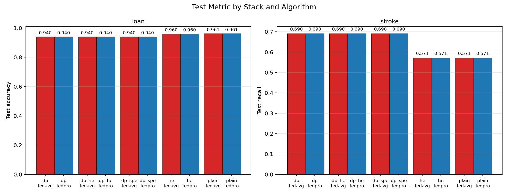
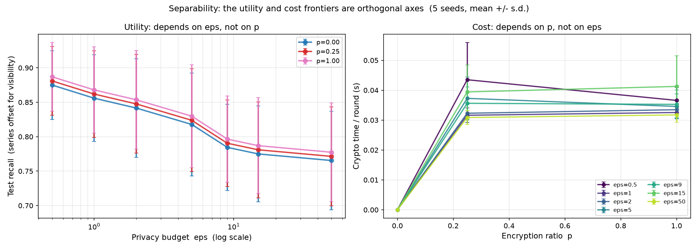
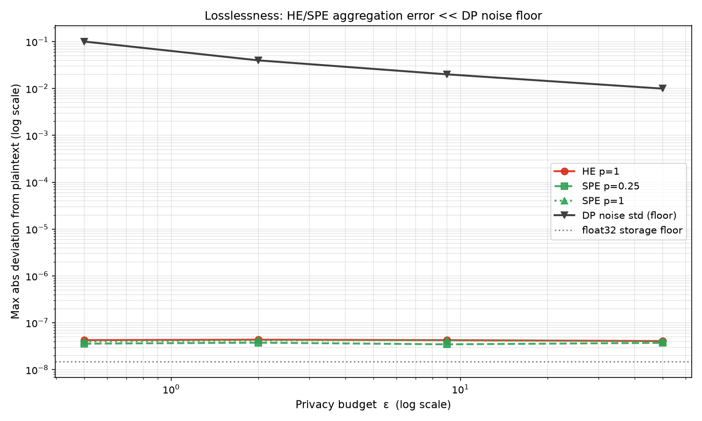
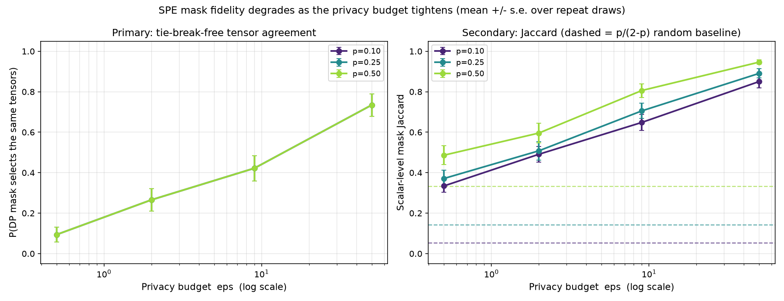
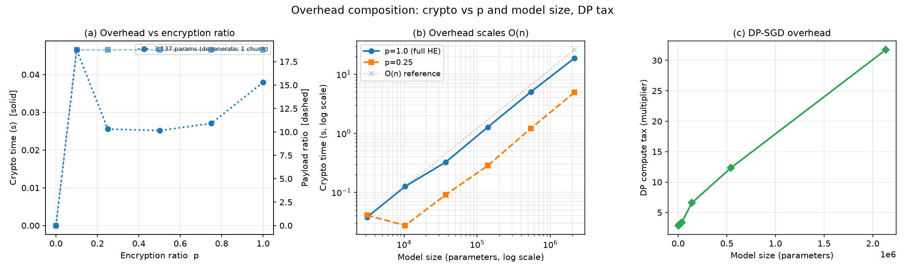

# Trial 07/27 — DP + FL + HE, simultaneously

**What this is.** The three prior ObscuraDP experiments each reproduced a paper that
held one leg of the privacy stack fixed. This trial composes all three into a single
pipeline in which differential privacy, federated learning and homomorphic encryption
run **at the same time**, and asks the questions none of them could answer alone.

| prior trial | contributed | could not test |
|---|---|---|
| [Experiment 1](../../Experiment%201) — arXiv:2508.10017 | non-IID Dirichlet clients, per-client SMOTETomek, FedProx, Opacus DP-SGD | no HE arm at all |
| [Experiment 2](../../Experiment%202) — Sci. Rep. 10.1038/s41598-025-34536-9 | the controlled arm matrix, CKKS aggregation, payload/latency accounting | DP **or** HE, never both |
| [Experiment 3](../../Experiment%203) — arXiv:2303.10837 (FedML-HE) | chunked CKKS, Selective Parameter Encryption, O(n) overhead, losslessness | no DP anywhere |

Five stacks form a lattice, so every privacy leg is isolated by exactly one controlled
change:

```
            plain  (FL only)
           /     \
      dp  /       \  he
   (FL+DP)         (FL+HE)
           \     /
            dp_he            (all three, naive full encryption)
              |
            dp_spe           (all three, selective encryption)
```

---

## 1. The three claims

1. **Separability** — utility depends only on ε, crypto cost only on the encryption
   ratio *p*. If true, the privacy/utility frontier and the privacy/cost frontier are
   orthogonal axes that an operator can tune independently.
2. **Losslessness survives noise** — Experiment 3 proved CKKS aggregation lossless on
   *clean* updates. Does it stay lossless when the updates it encrypts are DP-noised,
   and by what margin relative to the noise DP already injects?
3. **Sensitivity fidelity** — Experiment 3 picks the SPE mask from *clean* gradient
   magnitudes. Under DP-SGD the only gradients a real deployment can see are clipped
   and Gaussian-noised. Does the top-*p* ranking survive?

---

## 2. Setup

| Component | stroke | loan |
|---|---|---|
| Source | fedesoriano Stroke Prediction, 4,908 rows after cleaning, **4.26%** positive | Kaggle loan-approval, 4,269 rows, 11 features |
| Scaling | `StandardScaler` on age/glucose/BMI, fit on train | `MinMaxScaler`→[0,1] on all features (CKKS needs small magnitudes) |
| Partition | **Dirichlet(α=0.5)** over 5 clients, ≥12 of both classes each | **IID**, 5 × 683 |
| Client preproc | **SMOTETomek** per client | none (already near-balanced) |
| Test set | **class-balanced**, 84 rows (42 positive) | natural, 854 rows |
| Model | FFNN 15→64→32→1, **3,137 params** | MLP 11→32→16→1, **929 params** |
| Headline metric | recall | accuracy |
| Aggregation | **unweighted** (see §8) | sample-weighted |
| lr | 1e-4 (see §8) | 5e-3 |

Shared: 5 clients · **20 rounds** · 3 local epochs · Adam · batch 32 · FedProx μ=0.01.
DP: Opacus DP-SGD, Gaussian + RDP accounting, C=1.0, δ=1e-5, ε a **per-round** budget
(Experiment 1's convention; the composed cumulative spend is reported alongside).
HE: TenSEAL CKKS, `poly_modulus_degree=8192` (4096 slots), `coeff_mod=[60,40,60]`,
`scale=2^40`.

**New capability: weighted homomorphic aggregation.** Experiment 2 could use an
unweighted mean because its partition was IID; Experiment 1 needed sample-weighted
FedAvg because Dirichlet clients differ wildly in size. Running the non-IID task *under
encryption* therefore required applying weights without ever decrypting an individual
client vector. Each client's ciphertext is multiplied by its plaintext scalar weight
before summing — still multiplicative depth 1, so the `[60,40,60]` chain suffices
(verified: it admits exactly one scalar multiply, with **zero headroom**).

---

## 3. The arm matrix

`python run_arms.py` → `results/arms.json`, `results/arms.png`



*Headline metric per arm — loan accuracy (left), stroke recall (right); red = FedAvg,
blue = FedProx. The bars group by stack, and within each dataset the DP-bearing stacks
(`dp`, `dp_he`, `dp_spe`) are one flat level and the noise-free ones (`he`, `plain`)
another: the encryption arms land on their unencrypted counterparts, not somewhere
between. Note the two panels move in **opposite directions** — DP is below `plain` on
loan (0.940 vs 0.961) and above it on stroke (0.690 vs 0.571). The figure shows only the
headline metric; AUC, BCE and the crypto columns are in the tables below.*

**stroke** (ε=9.0, p=0.25 for `dp_spe`):

| algo | stack | recall | acc | AUC | pred-pos | BCE | crypto s/round | max\|Δ\| |
|---|---|---:|---:|---:|---:|---:|---:|---:|
| fedavg | plain | 0.5714 | 0.6667 | 0.7744 | 0.405 | 0.806 | — | 1.49e-08 |
| fedavg | dp | 0.6905 | 0.7262 | 0.8050 | 0.464 | 0.582 | — | 1.49e-08 |
| fedavg | he | **0.5714** | **0.6667** | 0.7744 | 0.405 | 0.806 | 0.0323 | 6.56e-08 |
| fedavg | dp_he | **0.6905** | **0.7262** | 0.8050 | 0.464 | 0.582 | 0.0325 | 6.56e-08 |
| fedavg | dp_spe | **0.6905** | **0.7262** | 0.8050 | 0.464 | 0.582 | 0.0291 | 6.56e-08 |
| fedprox | plain | 0.5714 | 0.6667 | 0.7761 | 0.405 | 0.796 | — | 1.49e-08 |
| fedprox | dp | 0.6905 | 0.7262 | 0.8050 | 0.464 | 0.580 | — | 1.49e-08 |
| fedprox | he | **0.5714** | **0.6667** | 0.7761 | 0.405 | 0.796 | 0.0315 | 6.56e-08 |
| fedprox | dp_he | **0.6905** | **0.7262** | 0.8050 | 0.464 | 0.580 | 0.0377 | 6.56e-08 |
| fedprox | dp_spe | **0.6905** | **0.7262** | 0.8050 | 0.464 | 0.580 | 0.0295 | 6.56e-08 |

**loan** (ε=9.0):

| algo | stack | acc | recall | AUC | BCE | crypto s/round |
|---|---|---:|---:|---:|---:|---:|
| fedavg | plain | 0.9614 | 0.9755 | 0.9946 | 0.099 | — |
| fedavg | dp | **0.9403** | 0.9397 | 0.9803 | 0.202 | — |
| fedavg | he | 0.9602 | 0.9755 | 0.9944 | 0.100 | 0.0306 |
| fedavg | dp_he | **0.9403** | 0.9397 | 0.9803 | 0.202 | 0.0302 |
| fedavg | dp_spe | **0.9403** | 0.9397 | 0.9803 | 0.202 | 0.0290 |
| fedprox | plain | 0.9614 | 0.9736 | 0.9939 | 0.105 | — |
| fedprox | dp | **0.9403** | 0.9416 | 0.9798 | 0.202 | — |
| fedprox | he | 0.9602 | 0.9699 | 0.9939 | 0.105 | 0.0288 |
| fedprox | dp_he | **0.9403** | 0.9416 | 0.9798 | 0.202 | 0.0288 |
| fedprox | dp_spe | **0.9403** | 0.9416 | 0.9798 | 0.202 | 0.0298 |

Both tables are the complete 10-arm matrix for their dataset; `results/arms.json` holds
all 20 records, and `results/arms_table_stroke.md` / `arms_table_loan.md` render them
with the F1 and ε-spend columns omitted here.

**What this shows.** On stroke, `he` reproduces `plain` and `dp_he` / `dp_spe` reproduce
`dp` to every digit reported above. The equality is *exact* where it can be: accuracy,
recall, precision, F1 and the predicted-positive rate are identical at **every one of the
20 rounds**, in all six pairings. The threshold-free metrics are not quite — over those
same 20 rounds AUC differs by at most 1.13e-03 and AP by 2.26e-03, and the BCE by at most
1.09e-04 per round (≤8.95e-05 at the final round). That residual is the ~6.6e-08 CKKS
weight perturbation (§5) reordering near-tied scores on an 84-row test set: 1.13e-03 is
exactly two swapped pairs, 2/(42·42). Encryption is applied at aggregation time and
changes nothing about what is learned; that equality is the *result*, not a coincidence.

On loan the equality is one notch looser and visibly so: `he` differs from `plain` in the
third digit (0.9614 vs 0.9602 accuracy — 821 vs 820 of 854 correct, a single flipped
prediction). Same cause, larger lever: 854 natural test rows resolve a 2.9e-07 weight
perturbation that 84 balanced rows do not.

Loan shows a **normal privacy cost** (0.9614 → 0.9403). Stroke does not — DP *beats*
the non-private arm there. That is a real property of the SMOTETomek recipe, discussed
honestly in §8 rather than smoothed over.

---

## 4. The joint ε × p frontier — the separability claim

`python run_frontier.py` → `results/frontier.json`, `results/frontier.png`

Every cell is a full 20-round run of the complete stack: DP-SGD locally, FedProx,
non-IID Dirichlet clients with per-client SMOTETomek, and CKKS aggregation of the
resulting noisy updates at encryption ratio *p* (at p=0.00 there is no ciphertext at
all — that column is the DP-only control the encrypted columns are measured against).



*Left: recall vs ε, one series per encryption ratio. **The three series are drawn with an
artificial ±0.006 vertical offset** (`plot_results.py`) — without it they hide behind
whichever draws last, because they are numerically identical. Their visible separation is
the plotting offset, not a result; their coincidence is. Right: crypto seconds/round vs
p, one series per ε. The seven ε series sit inside each other's error bars, which is the
ε-independence claim, and each is also **flat from p=0.25 to p=1.00** — that flatness is the
single-ciphertext floor, not an SPE result, as the note below the tables spells out. The
right panel's title ("Cost: depends on p, not on eps") is therefore only half earned
here: cost depends on whether p>0, and this model is too small to resolve any dependence
beyond that.*

**Headline — mean ± s.d. over 5 seeds (42–46), 105 full runs:**

| ε | p=0.00 | p=0.25 | p=1.00 | AUC | cumulative ε (seed 42) |
|---:|---:|---:|---:|---:|---:|
| 0.5 | 0.8810 ± 0.0499 | 0.8810 ± 0.0499 | 0.8810 ± 0.0499 | 0.7848 ± 0.0277 | 2.46 |
| 1.0 | 0.8619 ± 0.0628 | 0.8619 ± 0.0628 | 0.8619 ± 0.0628 | 0.7917 ± 0.0243 | 4.78 |
| 2.0 | 0.8476 ± 0.0716 | 0.8476 ± 0.0716 | 0.8476 ± 0.0716 | 0.7941 ± 0.0231 | 9.18 |
| 5.0 | 0.8238 ± 0.0747 | 0.8238 ± 0.0747 | 0.8238 ± 0.0747 | 0.7965 ± 0.0221 | 21.62 |
| 9.0 | 0.7905 ± 0.0628 | 0.7905 ± 0.0628 | 0.7905 ± 0.0628 | 0.7980 ± 0.0237 | 39.17 |
| 15.0 | 0.7810 ± 0.0697 | 0.7810 ± 0.0697 | 0.7810 ± 0.0697 | 0.7980 ± 0.0253 | 68.51 |
| 50.0 | 0.7714 ± 0.0716 | 0.7714 ± 0.0716 | 0.7714 ± 0.0716 | 0.8010 ± 0.0265 | 292.25 |

> The recall and AUC columns are 5-seed means from `results/multiseed.json`; the
> cumulative-ε column is the **seed-42** composed spend from `results/frontier.json`,
> because σ is solved per client per seed and the spend therefore varies by seed (at
> ε=9.0 the five seeds span 37.02–45.41, mean 40.86). It is a property of the accountant,
> not of the arm, so it is not averaged into the headline.

**Separability holds, in the strongest form available.** Not only are the means
identical across the encryption ratio — the **standard deviations are identical too**.
Across all 35 (seed, ε) cells, accuracy, recall, precision, F1, AUC, AP and the
predicted-positive rate are bitwise identical at p=0.00, 0.25 and 1.00; only the BCE
moves, by at most 3.4e-06. Encryption happens at aggregation time and is lossless (§5),
so for a given seed the three arms are literally the same computation with different
arithmetic underneath. Recall meanwhile moves 0.881 → 0.771 down the ε grid, and **never
increases** on any individual seed (each seed's curve is non-increasing, with plateaus —
seed 44 for instance holds 0.9048 across the first four ε before stepping to 0.8810).

Crypto cost is the mirror image — flat down each ε column (0.031–0.044 s/round, and the
variation is timing jitter on a shared 4-core machine, not an ε effect):

| ε | p=0.00 | p=0.25 | p=1.00 |
|---:|---:|---:|---:|
| 0.5 | 0.0000 | 0.0435 ± 0.0125 | 0.0366 ± 0.0043 |
| 1.0 | 0.0000 | 0.0316 ± 0.0025 | 0.0325 ± 0.0019 |
| 2.0 | 0.0000 | 0.0323 ± 0.0031 | 0.0335 ± 0.0028 |
| 5.0 | 0.0000 | 0.0373 ± 0.0072 | 0.0346 ± 0.0042 |
| 9.0 | 0.0000 | 0.0356 ± 0.0055 | 0.0353 ± 0.0048 |
| 15.0 | 0.0000 | 0.0394 ± 0.0090 | 0.0413 ± 0.0102 |
| 50.0 | 0.0000 | 0.0309 ± 0.0024 | 0.0317 ± 0.0025 |

**So the two frontiers are orthogonal axes.** An operator picks ε from the utility
column and *p* from the cost row, and neither choice constrains the other. None of the
three prior trials could have established this: Experiment 1 had no *p* axis,
Experiment 2 never varied both, and Experiment 3 had no ε axis.

> **What this panel does *not* show.** The cost table above is flat between p=0.25 and
> p=1.00 — 0.0358 s averaged down the p=0.25 column against 0.0351 s down p=1.00, with
> every row's difference inside its own ± s.d. That is **not** evidence that SPE fails
> to save anything — it is the single-ciphertext floor again. The stroke model's 3,137 parameters fit
> inside one 4096-slot ciphertext, so every p ≥ 1/4096 costs exactly one chunk. This
> frontier therefore demonstrates *cost is independent of ε* but says nothing about
> *cost vs p*. The linear-in-p result needs a model spanning many chunks and is in §7.

**A wrinkle worth stating.** Recall *falls* as ε loosens (0.881 → 0.771) while AUC
*rises* (0.7848 → 0.8010). These are not in conflict, and Experiment 1 documented the
same effect: because every client trains on SMOTE-balanced data, discrimination is
nearly constant, so ε mainly moves the **operating point**. More noise predicts more
positives — higher recall, lower precision — and less noise is more conservative. The
threshold-free metric is the one that improves with the privacy budget, in the textbook
direction — mean AUC never falls as ε loosens, rising at every step of the grid except
ε=9→15, where it is flat to 15 decimal places. Recall at a fixed 0.5 threshold moves the
other way. Reporting only one of them would misrepresent the trade-off.

Note also that the AUC spread (±0.022–0.028) is comparable to its trend across the whole
ε grid (0.785 → 0.801), so the threshold-free direction is suggestive at 5 seeds rather
than established. The recall trend is the solid one — it is non-increasing on every
individual seed, which is a stronger statement than the overlapping error bars alone
convey.

---

## 5. Losslessness under DP noise

`python run_losslessness.py` → `results/lossless.json`, `results/lossless.png`

The same DP-noised client updates, aggregated three ways — plaintext, full CKKS, and
SPE — and compared.



*Every series on one log axis. The three encrypted arms (HE p=1, SPE p=0.25, SPE p=1) lie
on a flat band at ~4e-08 across the whole ε grid, five to six orders of magnitude below
the DP noise std the same runs inject (black, falling 1.0e-01 → 9.9e-03 as ε loosens),
and within ~3× of the grey float32 storage floor at 1.49e-08. The **DP line falls while
the CKKS band does not move** — which is precisely the units mismatch called out in the
second bullet below: the two quantities live in different spaces, so their ratio is not a
meaningful measure of anything.*

All 12 records in `results/lossless.json`:

| ε | mode | p | max\|HE−plain\| | ÷ update scale | ÷ DP noise std |
|---:|---|---:|---:|---:|---:|
| 0.5 | he | 1.00 | 4.28e-08 | **5.08e-07** | 4.25e-07 |
| 0.5 | spe | 0.25 | 3.59e-08 | **4.27e-07** | 3.57e-07 |
| 0.5 | spe | 1.00 | 4.03e-08 | **4.79e-07** | 4.00e-07 |
| 2.0 | he | 1.00 | 4.37e-08 | **5.19e-07** | 1.10e-06 |
| 2.0 | spe | 0.25 | 3.77e-08 | **4.47e-07** | 9.46e-07 |
| 2.0 | spe | 1.00 | 4.24e-08 | **5.03e-07** | 1.06e-06 |
| 9.0 | he | 1.00 | 4.27e-08 | **5.05e-07** | 2.13e-06 |
| 9.0 | spe | 0.25 | 3.48e-08 | **4.12e-07** | 1.73e-06 |
| 9.0 | spe | 1.00 | 4.29e-08 | **5.08e-07** | 2.14e-06 |
| 50.0 | he | 1.00 | 4.08e-08 | **4.82e-07** | 4.11e-06 |
| 50.0 | spe | 0.25 | 3.74e-08 | **4.41e-07** | 3.76e-06 |
| 50.0 | spe | 1.00 | 4.04e-08 | **4.77e-07** | 4.06e-06 |

The `spe p=1.00` rows are the degenerate control: SPE told to encrypt everything must
land on the naive-HE path, and it does, to within the run-to-run scatter of the column
(4.77–5.08e-07 against HE's 4.82–5.19e-07).

**CKKS error is 4.1e-07 to 5.2e-07 of the update magnitude, at every ε and every p** —
a 1.26× spread across all twelve records. Encryption is free in utility terms, and stays
free when what it encrypts is noise.

Two calibrations make that number interpretable rather than merely small:

- **The float32 floor.** The aggregate is stored back into a float32 `state_dict`, so
  even the *plaintext* arm deviates from a float64 reference — by 1.49e-08 on stroke.
  The `dev_over_float32_floor` field of `results/arms.json` puts every plaintext and
  every `dp` arm exactly on that floor (ratio 1.000), and every encrypted arm a small
  multiple above it: on stroke **uniformly 4.400×** (6.56e-08 against 1.49e-08, the same
  value for `he`, `dp_he` and `dp_spe`, under both FedAvg and FedProx), and on loan
  **3.600× to 5.200×** (2.15e-07…3.10e-07 against a 5.96e-08 floor). Quoting one range
  spanning both datasets would be misleading — loan's floor is its own, and its 929
  parameters fill only 23% of a single ciphertext against stroke's 77%, a much more
  heavily padded regime (§7). The claim that survives either way: CKKS costs a small
  constant multiple of the rounding a plaintext federation already pays just to hold its
  weights, and the multiple stays under 6× on both datasets.
- **Normalise by the right thing.** The `rel_to_noise_floor` column above divides a
  *weight-space* deviation by a *gradient-space* per-step noise std. It is retained for
  continuity but it drifts 11.5× across ε while its numerator is flat — a units
  mismatch, not a finding. `rel_to_update_scale` is scale-free and duly invariant.

---

## 6. Does the SPE mask survive DP noise?

`python run_sensitivity.py` → `results/sensitivity.json`, `results/sensitivity.png`

Mean ± standard error over **64 draws** per cell.



*Left, the primary metric: P(the DP-scored mask picks the same tensors as the clean one)
rises monotonically with ε, 0.09 → 0.73. **The three p-curves are exactly superimposed**
— that is the six-tensor degeneracy described in the second caveat below, not three
measurements that happen to agree. Right, the secondary scalar-level Jaccard, with the
analytic p/(2-p) random baselines dashed in matching colours. Every measured curve sits
**above** its baseline at every ε, including the leftmost ε=0.5 point — which is the
retracted claim, refuted in the figure.*

| ε | P(same tensors) | Jaccard @ p=0.25 | random baseline | Spearman |
|---:|---:|---:|---:|---:|
| 0.5 | **0.094 ± 0.037** | 0.371 ± 0.041 | 0.1429 | 0.533 |
| 2.0 | **0.266 ± 0.056** | 0.508 ± 0.046 | 0.1429 | 0.874 |
| 9.0 | **0.422 ± 0.062** | 0.705 ± 0.037 | 0.1429 | 0.927 |
| 50.0 | **0.734 ± 0.056** | 0.891 ± 0.023 | 0.1429 | 0.983 |

**The finding: SPE's privacy targeting degrades monotonically as the budget tightens.**
At ε=50 the DP-chosen mask agrees with the clean one 73% of the time; at ε=0.5, 9%. The
mechanism is saturation — the DP scores collapse onto the noise floor
`E|N(0, σC/B)| = 0.0117`, compressing a clean score range that spans 52×
(5.13e-04 … 2.67e-02) into one spanning ≈1.26× on a typical draw. There is simply no
ranking signal left. (The clean span and the noise floor are re-measured independently in
[`VERIFICATION.md`](VERIFICATION.md); they are properties of the scorer and the σ grid,
not fields of `results/sensitivity.json`.)

**Utility is identical across mask modes** — clean, dp and random all give recall
0.6905 / acc 0.7262 / AUC 0.8050. That is expected and important: SPE is lossless
*whichever* parameters it encrypts, so the mask is a **privacy** decision, not a utility
one. Which is exactly why its degradation matters — it is invisible in the accuracy
numbers.

### A claim this trial retracted

An earlier version of this experiment reported that at ε=0.5 the DP mask fell **below**
the random baseline (Jaccard 0.044 vs 0.143), implying anti-correlation. **That does not
replicate and is withdrawn.** It rested on 3 repeats; over 64 draws the same estimator
gives 0.371 ± 0.041 — **5.6 standard errors** *above* baseline — with a per-draw standard
deviation of 0.33 and a **strictly bimodal** distribution: 30 of the 64 draws fall at or
below 0.0896, the other 34 at or above 0.4216, and not one lands in between. Three
repeats could never have supported the claim. The pre-fix 0.044 is not preserved in any
results file: `results/sensitivity.json` was regenerated at `SENS_REPEATS = 64`, so the
3-repeat estimate now survives only as the retracted number quoted here and in the note
in `obscura/config.py`.

Two methodological caveats, both real:

- **Jaccard-over-scalars is tie-break sensitive.** Every scalar inherits its tensor's
  single score, so **84% of the p=0.25 mask is decided by `np.argpartition` tie-breaking**
  rather than by sensitivity. Swapping the tie-break convention moves the ε=0.5 statistic
  between 0.15 and 0.47. The tie-break-free per-tensor selection probability is therefore
  the primary metric; Jaccard is kept as a secondary column.
- **The p-columns are degenerate here.** P(same tensors) is identical at p=0.1, 0.25 and
  0.5 because one weight matrix holds 2,048 of 3,137 parameters, so the greedy top-*p*
  fill lands in the same tensor at all three fractions. That is a limitation of a
  six-tensor model, not a property of SPE.

---

## 7. Overhead composition

`python run_overhead.py` → `results/overhead.json`, `results/overhead.png`



*(a) Crypto time (solid, left axis) and payload ratio (dashed, right axis) against p. The
orange 541,697-param model is a straight line through the origin on both; the blue
3,137-param model is the degenerate control — its crypto time never leaves the floor and
its payload ratio jumps to 18.76× at p=0.1 and stays there, because one ciphertext is one
ciphertext. **The two blue curves are what "SPE saves nothing" looks like when the model
is smaller than a single ciphertext**, and are the reason the orange model exists. (b)
Crypto time vs model size on log-log, against a plotted O(n) reference — both p=1.0 and
p=0.25 run parallel to it across the 680× range. (c) The DP compute multiplier against
model size, on a linear axis: 2.5× at 3k params, 37.7× at 2.1M.*

**SPE is linear in p** (at 541,697 params, 14→133 ciphertext chunks):

| p | chunks | crypto s | ÷ crypto(p=1) | payload | wire payload |
|---:|---:|---:|---:|---:|---:|
| 0.10 | 14 | 0.3660 | **0.100** | 1.521 | 2.421 |
| 0.25 | 34 | 0.9083 | **0.249** | 3.693 | 4.443 |
| 0.50 | 67 | 1.8454 | **0.505** | 7.278 | 7.778 |
| 0.75 | 100 | 2.6480 | **0.725** | 10.862 | 11.112 |
| 1.00 | 133 | 3.6514 | 1.000 | 14.447 | 14.447 |

> `payload_ratio` counts only the ciphertext; `wire_payload_ratio` adds the unencrypted
> remainder the client still transmits at p<1. The two coincide at p=1.

**DP and HE taxes do not interact:**

| params | DP multiplier | HE payload | HE µs/param |
|---:|---:|---:|---:|
| 3,137 | 2.50× | 18.76× | 7.97 |
| 10,369 | 2.19× | 17.02× | 7.03 |
| 37,121 | 3.74× | 15.85× | 6.60 |
| 139,777 | 4.82× | 14.73× | 6.46 |
| 541,697 | 10.19× | 14.45× | 6.20 |
| 2,131,969 | **37.70×** | **14.38×** | **6.19** |

**DP's tax is local compute and grows with model size** (per-sample gradients) — 2.50×
to 37.70× over the range, though not monotonically: the 10,369-param row dips to 2.19×,
below the 3,137-param row, because at that size both arms are still dominated by
fixed per-batch overhead. **HE's tax is communication and is asymptotically constant per
parameter** — a flat ~6.2–8.0 µs/param across a 680× range, which is the O(n) claim
reproduced. They touch disjoint parts of a round.

### The payload ratio is quantised, and that explains everything

The same CKKS configuration reports 63.3× at loan's 929 parameters, 18.76× at stroke's
3,137, and 14.38× at 2.13M. This looks inconsistent until you measure the quantum: a
**full 4096-slot ciphertext serialises to 235,359 bytes and a one-slot ciphertext to
235,386 bytes** — 27 bytes apart. Payload is quantised in whole ciphertexts:

```
payload_ratio(n) = ceil(n / slots) · bytes_per_ciphertext / (4n)
```

which decays to a **14.365× asymptote** (`bytes_per_ciphertext / (4 · slots)`, the
`payload_ratio_asymptote` field of `results/overhead.json`) — matching Experiment 3's
published 14.4×; the largest model measured here, 2.13M params, has already reached
14.379×. Two checks. Calibrated with one quantum for the whole curve, the model predicts
18.7569× at 3,137 params against a measured 18.7570×, and 14.3791× at 2.13M against a
measured 14.3790× — agreement to 1e-5 relative. And because the quantum cancels in the
ratio, the model's own 18.757/14.365 must equal 4096/3137; it does, both 1.305706, to
2e-16.

The same quantisation is why the width-1 row in the p-sweep is **flat at 18.757 for
every p**: on a model smaller than one ciphertext, every p ≥ 1/4096 costs exactly one
chunk. It is retained in the results tagged `regime = "degenerate_single_chunk"` as an
illustration of the floor, and must not be read as "SPE saves nothing".

---

## 8. What broke, and what it revealed

Two defects made the first version of the stroke results worthless. Both are documented
with measurements in [`DIAGNOSIS.md`](DIAGNOSIS.md).

> **Every number in this section describes the PRE-FIX state and none of it is
> reproducible from the current results.** The pre-fix arm matrix is preserved verbatim
> at `results/arms_BROKEN_reference.json` (note its `"rounds": 10`); the client-partition
> and optimiser-probe measurements are in `DIAGNOSIS.md` and summarised in
> `obscura/config.py`. `results/arms.json` and every other file under `results/` were
> regenerated after the fix and contain none of these values.

**The non-private arms collapsed** — pre-fix stroke `fedavg`/`plain` finished at BCE
**7.76** with a predicted-positive rate of **0.048** on a *balanced* test set
(`arms_BROKEN_reference.json`; the same arm is now BCE 0.806 at 0.405). Per-client
SMOTETomek leaves each client a **locally separable** problem — the largest client
interpolates 2,460 positives from **22 real ones**. Plain BCE on a separable set has no
finite minimiser, so unclipped Adam only inflates the logit scale: across those 10 rounds
pooled train accuracy sat flat at 0.86 while mean |logit| grew 3.32 → 12.90
(`DIAGNOSIS.md`). The DP arms merely *looked* better because Opacus's clipping bounded
them. Experiment 1 never surfaced this because it has no non-private arm — every one of
its runs went through Opacus.

Sample-weighted FedAvg compounded it: after resampling, `n_c` counts how aggressively a
client duplicated its minority class, so on the pre-fix stroke partition the most
imbalanced client took **65.6%** of the aggregate while holding 13.2% of the real stroke
cases, and the client holding **55.7% of all real cases** took 3.1% (`DIAGNOSIS.md`).

**The ε axis was degenerate** — pre-fix, ε = 0.5, 1.0 and 9.0 all landed on the same
metrics (recall 0.5238 alike). Adam's scale invariance is real and measured (weight
displacement saturates at 0.429 and stops tracking σ; under SGD it scales properly,
0.006→0.130 — `DIAGNOSIS.md`), but the dominant cause was `ROUNDS` having been halved
20→10 to pay for the second dataset, which left every ε bunched at the start of the
trajectory. The post-fix ε axis is the §4 frontier, which moves 0.881 → 0.771.

Fixes: `ROUNDS` back to 20, stroke `LR` 1e-3→1e-4, and unweighted aggregation for the
resampled task.

### The finding this leaves standing

On stroke, **DP outperforms the non-private arm** (recall 0.6905 vs 0.5714). This is not
forced into the expected shape because it is genuine: `plain` is now well-calibrated
(pred-positive 0.405 on a 50/50 test set) and is simply the ε→∞ endpoint of the same
trajectory, fitting the 112×-duplicated synthetic positives hardest. Within the DP grid
privacy *does* cost utility in the textbook direction on threshold-free metrics. Loan —
IID and unresampled — shows a normal privacy cost on every metric. **The effect belongs
to the SMOTETomek recipe, not to DP.**

---

## 9. Independent verification

The crypto claims were re-derived against raw TenSEAL/Opacus, deliberately **not**
through this package's own `he.py`/`aggregate.py`, since those were the code under test.
See [`VERIFICATION.md`](VERIFICATION.md); reproduce with `python verify_claims.py` (~17 s).

The figures in this table are the auditor's own re-measurements, not fields of
`results/*.json` — **[`VERIFICATION.md`](VERIFICATION.md) is authoritative for them** and
the row below is a summary of it.

| claim | verdict | key evidence |
|---|---|---|
| CKKS + SPE lossless on DP-noised updates | **CONFIRMED** | independently measured 4.91e-08…6.65e-08 against the trial's 4.90e-08…6.90e-08; an off-by-one scatter positive control yields 3.10e+00, so the test has ~7 orders of discriminating power |
| Weighted homomorphic aggregation | **CONFIRMED** | rel. error flat at ~1.3e-07 for \|v\| ≥ 0.1 (it rises to 6.3e-06 at \|v\|=1e-3, where absolute error meets the CKKS scale floor); `[60,40,60]` admits exactly one scalar multiply, with zero headroom |
| Payload ratio is padding, not a chain difference | **CONFIRMED** | asymptote 14.365×, matching Experiment 3 |
| `dp_noise_std = σ·C/B` | **CONFIRMED, one correction** | measured grad std 1.5516 vs predicted 1.5625. `B` should be Opacus's `expected_batch_size` (29–32), so the floor is understated by ≤10% |
| Mask degradation under DP | **CONFIRMED** | saturation onto `E|N(0,σC/B)| = 0.0117`; clipping verified as the standard *joint* `min(1, C/‖g‖)` |
| Mask falls *below* random at ε=0.5 | **REFUTED** | see §6, "A claim this trial retracted" |

---

## 10. Reproduce

```bash
python3.11 -m venv ../../obscura_env && source ../../obscura_env/bin/activate
pip install -r requirements.txt
python run_smoke.py          # 7-check end-to-end sanity (~15 s)
python run_arms.py           # Exp A  arm matrix          -> results/arms.json
python run_frontier.py       # Exp B  joint eps x p       -> results/frontier.json
python run_losslessness.py   # Exp C  losslessness        -> results/lossless.json
python run_sensitivity.py    # Exp D  mask fidelity       -> results/sensitivity.json
python run_overhead.py       # Exp E  overhead            -> results/overhead.json
python run_multiseed.py      # Exp F  5 seeds             -> results/seed_{42..46}.json
python aggregate_seeds.py    #        pool the 5 seeds    -> results/multiseed.json
python verify_claims.py      # independent cross-check
python plot_results.py       # all five figures
```

Both datasets ship in `data/` — nothing is ever downloaded.

### Layout

```
Trial 07/27/
├── obscura/
│   ├── config.py         every hyperparameter (single source of truth)
│   ├── data.py           both datasets, scaling, non-IID/IID partition, SMOTETomek
│   ├── models.py         the FFNN family, flatten <-> state_dict
│   ├── dp.py             sigma solving, RDP accounting, Opacus wiring, noise floors
│   ├── he.py             CKKS context, chunked encryption, naive + SPE + weighted
│   ├── sensitivity.py    clean and DP-aware scoring, top-p masks, agreement metrics
│   ├── fedprox.py        one client's local round (plaintext or DP-SGD, +/- proximal)
│   ├── metrics.py        held-out evaluation, multi-run summarisation
│   ├── aggregate.py      the single place plaintext / HE / SPE aggregation meet
│   ├── orchestrator.py   the full-stack federated loop
│   └── bench.py          crypto and DP overhead harness, padding model
├── run_smoke.py  run_arms.py  run_frontier.py  run_losslessness.py
├── run_sensitivity.py  run_overhead.py  run_multiseed.py  aggregate_seeds.py
├── verify_claims.py  plot_results.py
├── DIAGNOSIS.md  VERIFICATION.md
└── data/  results/  logs/  requirements.txt
```

`results/` holds the six authoritative JSON files, the five PNGs embedded above, the
rendered `*_table.md` companions, the per-seed `seed_4{2..6}.json`, and
`arms_BROKEN_reference.json` (the pre-fix matrix kept for §8). `logs/` holds the shell
scripts each long driver was launched under.
